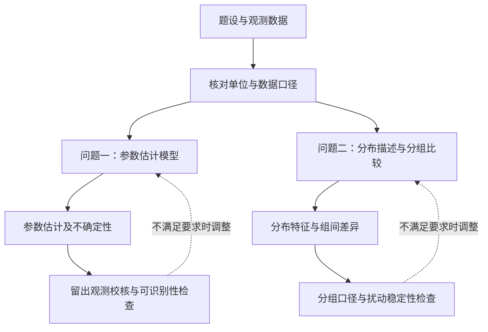
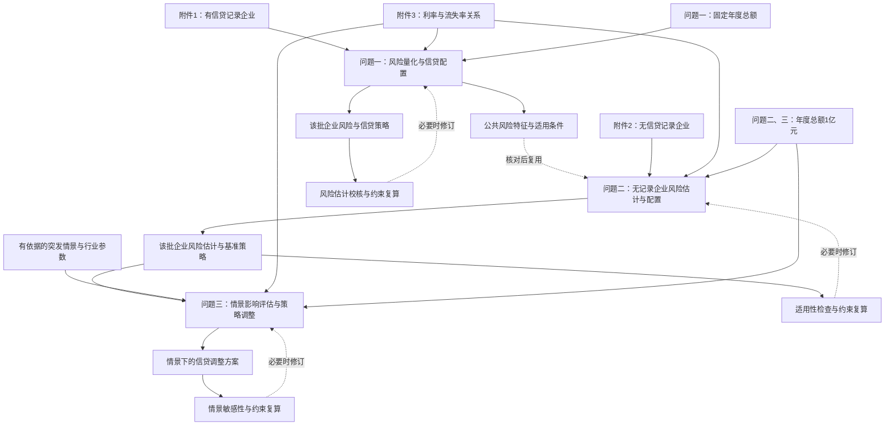

# 按需提供的整体建模流程图

仅在用户明确要求提供流程图，或审查范围包含已有流程图时读取本文件。问题分析默认只交付正文，不自动附图、图框架或 Mermaid 源码。用户要求绘图后，按指定位置安排；未指定位置时可放在所有子问题分析之后，并用一句正文引入。

目的：让读者看清各问用什么解决什么、什么信息流向哪里、检验针对哪项模型。

## 先列节点和边，再排版

节点按需取用：题设/附件输入、关键特征处理、各问模型或方法、对应输出、检验、必要的修订入口。不要求固定节点数，不把每个程序步骤都画进去。

每条跨问箭头都说明传递的具体信息；无结果依赖时用并列分支。区分实线数据或结果流、虚线检验反馈/方法复用，并在图注解释约定。实际检验与拟实施检验不可混写。

图中文字与章节采用同一模型名称和问题编号。结果节点写输出类型，如“风险估计与额度方案”，不预填尚未产生的数值或“最优解”。

## 示例 A：共享数据，但两问独立

原创教学情境：同一观测数据用于参数估计与描述性分布分析，后者不采用前者估计结果。这是结构演示，不对应某届真题。

引导句：“各问共享数据口径核对环节，之后分别完成参数估计与分布分析，其模型和检验关系如图所示。”

不可为了连续排版将 O1 连到 Q2。

## 示例 B：信贷研究的拟定路线

基于作者整理的 2020 C 任务编制的方案示例，模型尚需实际附件和建模材料确认。问题二迁移的是适用的风险表达，不能直接把问题一企业的风险结果用于另一批企业。

图注建议：“整体建模方案示意。实线表示输入或结果流，虚线表示有条件的方法复用或检验反馈；具体模型及检验方式以实际建模为准。”

正式回写时，把泛称换成实际模型名称并删除不符合实际路线的节点；图太大时合并共同约束并通过图注说明，不删掉重要的依赖语义。

## 输出和验证

- 用户要求流程图且采用 Markdown 交付时，可给 Mermaid；选择普通字母作为节点 ID，将中文标签放在引号中。
- 用户不要图时省略；只要图框架时给节点与关系即可。
- 未定模型使用“拟定方案/建模方案示意”，不能图中写已验证而文字仍是计划。
- 需要图片或正式文档时，按用户目标格式输出并检查裁切、中文、箭头、缩放后的可读性；源代码可解析并不等于版面验证通过。
- 没有可用绘图工具时如实提供可编辑源码或节点说明，不冒称渲染完成。

是否画图取决于它能否清楚展示任务结构；没有可核验来源的获奖论文配图比例不作为推荐依据。
